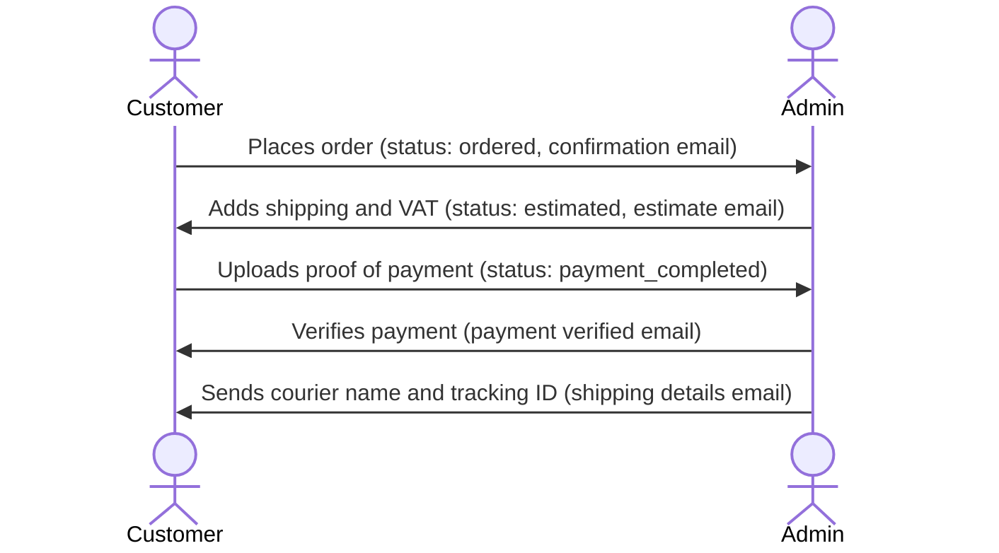

# N & S Handicrafts

A full-stack store built with Laravel 11 for the Nepalese market: NPR pricing, local addresses, VAT-based checkout and courier tracking. Customers browse the catalogue, keep a wishlist, apply coupons and place orders through an estimate-first checkout, where the store confirms shipping and VAT before the customer pays and uploads proof of payment. Administrators run the business from one panel: catalogue, coupons, home-page slides, orders, payment verification, shipping and customer queries, with transactional emails at each stage of an order.

| Home | Cart | Admin dashboard |
|---|---|---|
|  |  |  |

## Features

- Shop page with category, brand and price-range filters, sorting and page-size options, plus live product search.
- Product pages with an image gallery and related products; product images are cropped and resized to 540 × 689 on upload.
- Wishlist with move-to-cart, and a cart with quantity controls.
- Discount coupons (fixed or percentage, with a minimum cart value and an expiry date) and a pre-estimated VAT line before checkout.
- Checkout with Nepali address fields (province and district), an international phone input and a saved address book with a default address.
- Customer accounts with email OTP verification at registration, OTP password reset, order history and order cancellation.
- Admin panel with order, sales and product statistics; management of products, categories, brands, coupons and slides; payment-receipt verification; courier and tracking details; and replies to contact queries.
- Seven mailables covering order confirmation, estimate, payment received, payment verified, shipping details and contact-query receipt and reply.

## Architecture

Standard Laravel MVC. Routes in `routes/web.php` reach controllers for the shop, cart and checkout, customer account, wishlist and admin area. Admin routes pass through `AdminAuthentication` middleware, which only lets in users whose `usertype` is `admin`. Eloquent models map to MySQL tables created by the migrations in `database/migrations`, and Blade views render the storefront, account area, admin panel and emails.

Orders follow an estimate-first workflow, tracked by the `status` column on `orders`:



Main models: `Product`, `Category`, `Brand`, `Coupon`, `Order`, `OrderItem`, `Transaction`, `PaymentVerification`, `ShippingDetail`, `Address`, `Slide`, `ContactQuery`, `User`.

## Tech stack

| Layer | Technology |
|---|---|
| Back end | Laravel 11, PHP 8.2+ |
| Database | MySQL / MariaDB |
| Front end | Blade, Bootstrap 5, jQuery |
| Authentication | Laravel UI with custom email OTP verification |
| Cart | `surfsidemedia/shoppingcart` |
| Images | PHP GD (resize and crop on upload) |
| Email | Laravel Mail (SMTP) |
| Build tooling | Vite |
| Testing and style | PHPUnit, Laravel Pint |

## Getting started

### Prerequisites

- PHP 8.2+ with the `gd`, `fileinfo`, `mbstring`, `openssl` and `pdo_mysql` extensions
- Composer 2
- MySQL or MariaDB
- Node.js and npm (only to rebuild front-end assets)

### Environment

Copy `.env.example` to `.env`. It defaults to SQLite, but some migrations use MySQL-specific SQL, so switch to MySQL:

| Variable | Purpose |
|---|---|
| `APP_NAME`, `APP_URL` | Store name and base URL |
| `DB_CONNECTION` | Set to `mysql` |
| `DB_HOST`, `DB_PORT`, `DB_DATABASE`, `DB_USERNAME`, `DB_PASSWORD` | Database connection |
| `MAIL_MAILER` | `log` (the default) writes emails, including OTP codes, to `storage/logs/laravel.log`; `smtp` sends them |
| `MAIL_HOST`, `MAIL_PORT`, `MAIL_USERNAME`, `MAIL_PASSWORD`, `MAIL_FROM_ADDRESS` | SMTP settings when `MAIL_MAILER=smtp` |

### Install and run

```bash
git clone https://github.com/Sabin78910/Ecommerce-Website.git
cd Ecommerce-Website
composer install
npm install
cp .env.example .env
php artisan key:generate
# edit .env: DB_CONNECTION=mysql and your database credentials
php artisan migrate --seed
php artisan storage:link
php artisan serve
```

Open `http://127.0.0.1:8000` for the store and `http://127.0.0.1:8000/admin` for the admin panel. The seeder (`database/seeders/UserSeeder.php`) creates a local administrator account; change its credentials before using the app anywhere shared.

To rebuild front-end assets after editing `resources/`, run `npm run build` (or `npm run dev` while developing).

### Test

```bash
php artisan test
./vendor/bin/pint
```

## Project structure

| Path | Contents |
|---|---|
| `app/Http/Controllers` | Shop, cart and checkout, user account, wishlist and admin controllers; `Auth/` and `Admin/` subfolders |
| `app/Http/Middleware` | `AdminAuthentication` |
| `app/Mail` | Order, payment, shipping and contact-query mailables |
| `app/Models` | Eloquent models |
| `config` | Laravel configuration, including `cart.php` for the cart and tax settings |
| `database` | Migrations and seeders |
| `docs/screenshots` | README images |
| `public` | Theme assets and uploaded catalogue images |
| `resources/views` | Blade templates for the storefront, account area, admin panel and emails |
| `routes/web.php` | All web routes |
| `tests` | PHPUnit feature and unit tests |

## Testing and CI

PHPUnit and Laravel Pint are configured. The `tests` folder currently holds only Laravel's default example tests, and there is no CI workflow.

## Design decisions and limitations

- Estimate-first ordering lets the store confirm shipping cost and VAT before taking payment, at the cost of a slower checkout for the customer.
- Payment is by uploaded receipt and manual verification. A PayPal handler exists in `ControllerCart`, but no route uses it.
- The VAT rate used for the pre-estimate comes from `config/cart.php`, so it has to be kept in line with the rate the store charges.
- Some migrations use MySQL-specific SQL, so the project does not run on the SQLite default in `.env.example`.
- Automated test coverage is minimal.

## Author

**Sabin Khanal**. [Portfolio](https://sabinkhanal13.com.np) · [LinkedIn](https://www.linkedin.com/in/sabin-khanal-950163326) · [GitHub](https://github.com/Sabin78910)
