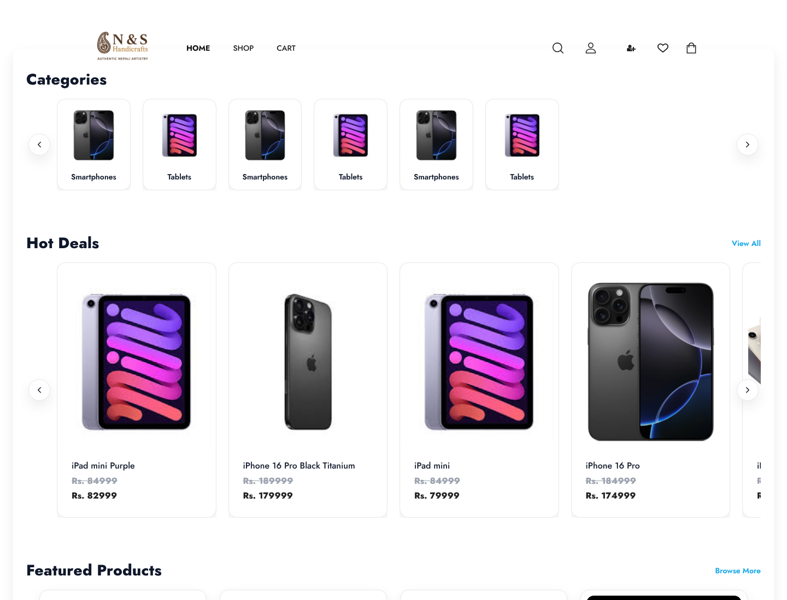
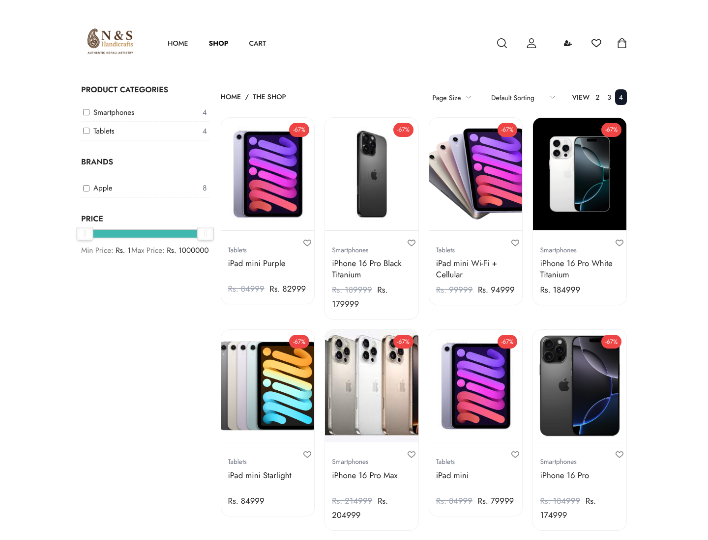
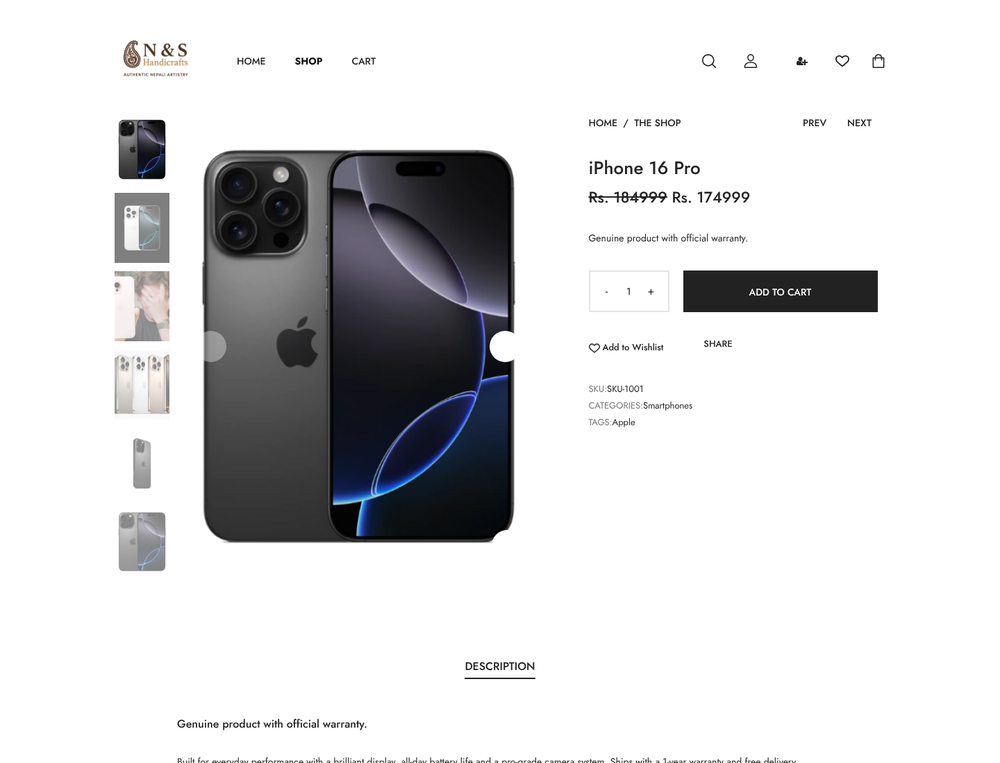
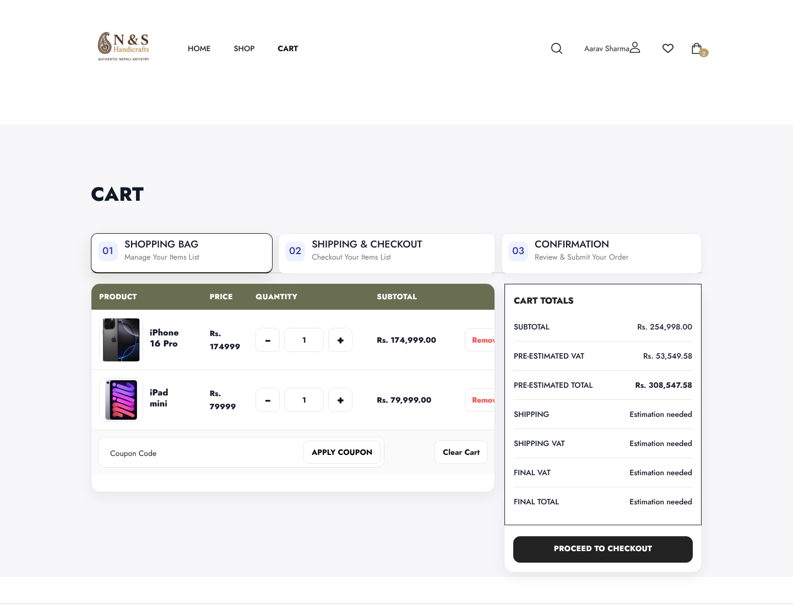
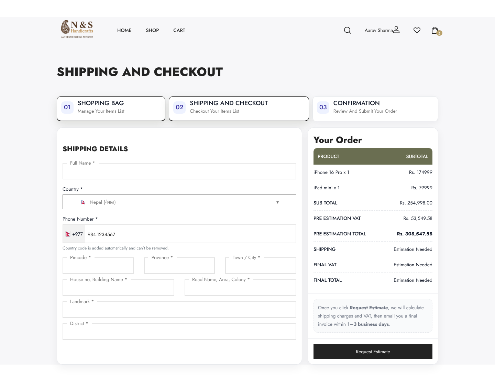
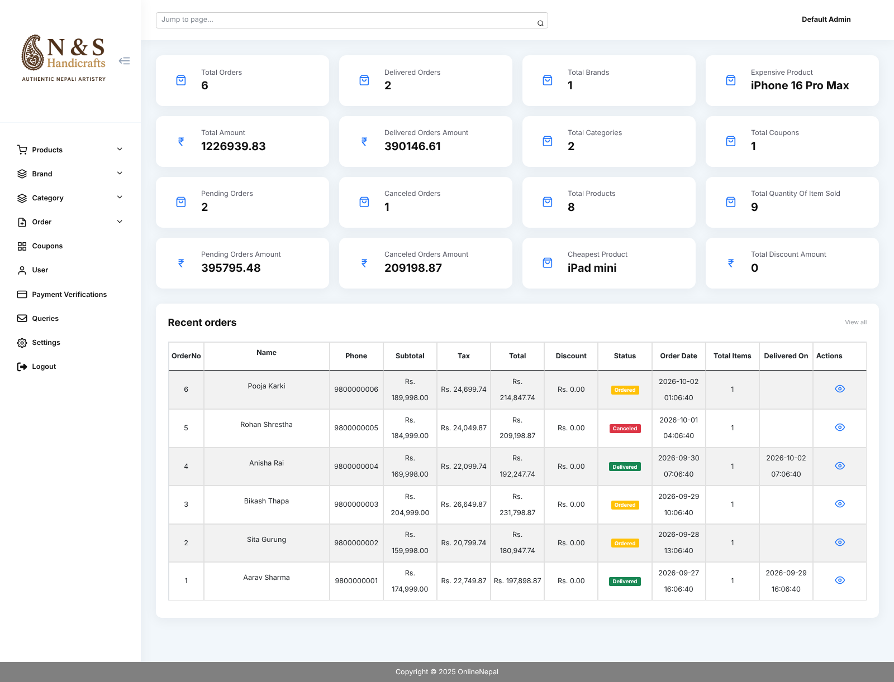
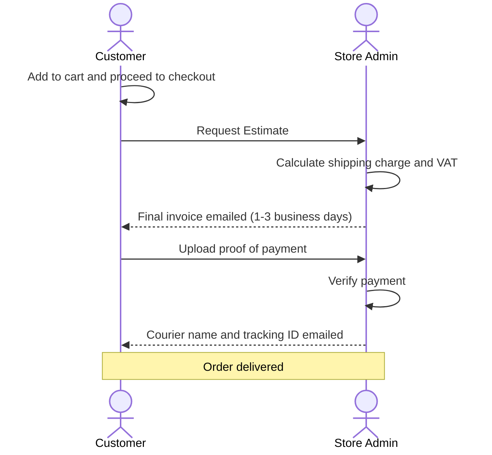
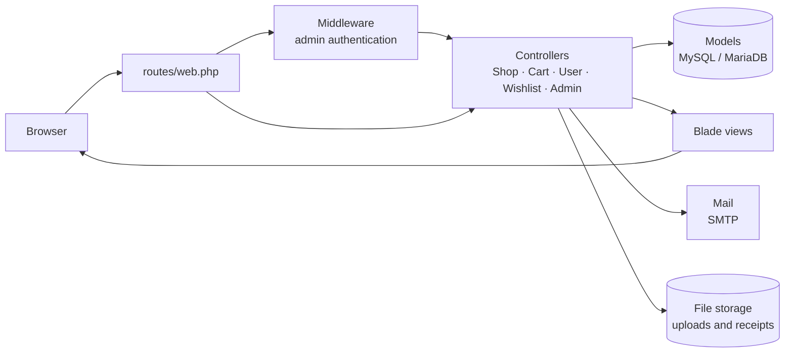

<div align="center">

<a id="readme-top"></a>


# N & S Handicrafts

### Full-stack e-commerce platform built with Laravel 11

Storefront · Cart · Estimate-based checkout · Complete admin panel

[](https://www.php.net/)
[](https://laravel.com/)
[](https://www.mysql.com/)
[](https://getbootstrap.com/)
[](https://opensource.org/licenses/MIT)

[Report a Bug](https://github.com/Sabin78910/Ecommerce-Website/issues/new?labels=bug) · [Request a Feature](https://github.com/Sabin78910/Ecommerce-Website/issues/new?labels=enhancement)

</div>

---

## Table of Contents

- [Overview](#overview)
- [Quick Start](#quick-start)
- [Screenshots](#screenshots)
- [Features](#features)
- [How Ordering Works](#how-ordering-works)
- [Architecture](#architecture)
- [Tech Stack](#tech-stack)
- [Getting Started](#getting-started)
- [Usage](#usage)
- [Testing and Code Style](#testing-and-code-style)
- [Project Structure](#project-structure)
- [Deployment](#deployment)
- [Security](#security)
- [Troubleshooting](#troubleshooting)
- [Roadmap](#roadmap)
- [Contributing](#contributing)
- [License](#license)
- [Contact](#contact)

---

## Overview

**N & S Handicrafts** is an e-commerce web application built with [Laravel](https://laravel.com). Customers browse the catalogue, save items to a wishlist, apply discount coupons and place orders through an estimate-based checkout. Store administrators manage the entire business from one dashboard: products, categories, brands, coupons, home-page slides, orders, payments, shipping and customer queries.

The platform is localised for Nepal. Prices are shown in Nepalese Rupees (Rs.), and checkout supports Nepali addresses (province and district) alongside international phone numbers.

| Area | Highlights |
| ---- | ---------- |
| **Storefront** | Category carousel, filters and sorting, live search, product gallery, wishlist |
| **Checkout** | Coupons, VAT estimate, estimate-based ordering, proof-of-payment upload |
| **Accounts** | Email OTP verification, order history, address book |
| **Admin** | Catalogue, order, payment and shipping management with sales statistics |
| **Email** | Transactional emails for every stage of an order |

<p align="right">(<a href="#readme-top">back to top</a>)</p>

## Quick Start

Requires PHP 8.2+, Composer 2 and a MySQL / MariaDB database. Full instructions are in [Getting Started](#getting-started).

```bash
git clone https://github.com/Sabin78910/Ecommerce-Website.git
cd Ecommerce-Website
composer install && npm install
cp .env.example .env && php artisan key:generate
# set DB_CONNECTION=mysql and your database credentials in .env
php artisan migrate --seed
php artisan storage:link
php artisan serve
```

Then open **http://127.0.0.1:8000**.

<p align="right">(<a href="#readme-top">back to top</a>)</p>

## Screenshots

<table>
  <tr>
    <td width="50%" align="center">
      
      <br><sub><b>Home</b> · categories, hot deals and featured products</sub>
    </td>
    <td width="50%" align="center">
      
      <br><sub><b>Shop</b> · category, brand and price filters with sorting</sub>
    </td>
  </tr>
  <tr>
    <td width="50%" align="center">
      
      <br><sub><b>Product details</b> · image gallery and add to cart</sub>
    </td>
    <td width="50%" align="center">
      
      <br><sub><b>Cart</b> · quantities, coupons and VAT estimate</sub>
    </td>
  </tr>
  <tr>
    <td width="50%" align="center">
      
      <br><sub><b>Checkout</b> · shipping details and estimate request</sub>
    </td>
    <td width="50%" align="center">
      
      <br><sub><b>Admin dashboard</b> · sales statistics and recent orders</sub>
    </td>
  </tr>
</table>

<sub>Screenshots use the sample catalogue images included in <code>public/uploads</code>.</sub>

<p align="right">(<a href="#readme-top">back to top</a>)</p>

## Features

### Storefront

- Home page with category carousel, **Hot Deals** and **Featured Products**
- Shop page with category, brand and price-range filters, sorting and page-size options
- Product pages with image gallery, lightbox and related products
- Live product search
- Wishlist with move-to-cart
- Informational pages: About, FAQs, Terms, Refund & Cancellation and Contact

### Cart and Checkout

- Cart with quantity controls and remove / clear actions
- Discount coupons: fixed or percentage, with minimum cart value and expiry date
- Pre-estimated VAT shown before checkout
- Shipping form with Nepali address fields and international phone input
- Estimate-based ordering with proof-of-payment upload (see [How Ordering Works](#how-ordering-works))

### Customer Accounts

- Registration with **email OTP verification**
- Password reset via OTP
- Order history, order details and order cancellation
- Address book with a default address
- Account details and password management

### Admin Panel

- Dashboard with order counts, sales amounts and product statistics
- Full management of products (main image and gallery, auto-resized), categories, brands, coupons and home-page slides
- Order management with status updates and courier / tracking details
- Payment verification for uploaded receipts
- Customer list with order counts
- Contact queries with email replies
- Quick page search across the admin area

### Email Notifications

OTP codes, order confirmation, order estimate, payment received, payment verified, shipping details and contact-query replies.

<p align="right">(<a href="#readme-top">back to top</a>)</p>

## How Ordering Works

Orders follow an estimate-first workflow so the store can calculate shipping and VAT before the customer pays.



<p align="right">(<a href="#readme-top">back to top</a>)</p>

## Architecture

The application follows Laravel's MVC conventions, with separate controllers and views for the storefront, customer area and admin panel.



| Concern | Where it lives |
| ------- | -------------- |
| Routing | `routes/web.php` |
| Request handling | `app/Http/Controllers` (storefront, cart, accounts, admin) |
| Access control | `app/Http/Middleware` (admin authentication) |
| Data | `app/Models` and `database/migrations` |
| Presentation | `resources/views` (admin, user, emails, layouts) |
| Notifications | `app/Mail` and `resources/views/emails` |

<p align="right">(<a href="#readme-top">back to top</a>)</p>

## Tech Stack

| Layer | Technology |
| ----- | ---------- |
| Backend | Laravel 11, PHP 8.2+ |
| Database | MySQL / MariaDB |
| Frontend | Blade, Bootstrap 5, jQuery, Swiper, noUiSlider, SweetAlert, intl-tel-input |
| Authentication | Laravel UI with custom email-OTP verification |
| Cart | `surfsidemedia/shoppingcart` |
| Images | Intervention Image (product images resized to 540 × 689) |
| Email | Laravel Mail (SMTP) |
| Build tooling | Vite, Sass, Tailwind CSS |
| Testing / Linting | PHPUnit, Laravel Pint |

<p align="right">(<a href="#readme-top">back to top</a>)</p>

## Getting Started

### Prerequisites

- **PHP 8.2+** with the `bcmath`, `ctype`, `fileinfo`, `gd`, `mbstring`, `openssl`, `pdo_mysql`, `tokenizer` and `xml` extensions
- **Composer 2**
- **MySQL 8+** or **MariaDB 10.6+**
- **Node.js 20+** and **npm** (only required if you change files in `resources/`)
- **Git**

### Installation

1. **Clone the repository**

   ```bash
   git clone https://github.com/Sabin78910/Ecommerce-Website.git
   cd Ecommerce-Website
   ```

2. **Install dependencies**

   ```bash
   composer install
   npm install
   ```

3. **Create the environment file and application key**

   ```bash
   cp .env.example .env
   php artisan key:generate
   ```

4. **Configure the database.** Create an empty MySQL database and update `.env` (see [Environment Configuration](#environment-configuration)). The migrations use MySQL syntax, so change `DB_CONNECTION` from `sqlite` to `mysql`.

5. **Run migrations and seed the admin account**

   ```bash
   php artisan migrate --seed
   ```

6. **Link storage** (required for payment receipts)

   ```bash
   php artisan storage:link
   ```

7. **Start the application**

   ```bash
   php artisan serve
   ```

   Open **http://127.0.0.1:8000** in your browser.

### Environment Configuration

| Variable | Description | Example |
| -------- | ----------- | ------- |
| `APP_NAME` | Store name used in page titles and emails | `"N & S Handicrafts"` |
| `APP_URL` | Base URL of the application | `http://127.0.0.1:8000` |
| `DB_CONNECTION` | Database driver | `mysql` |
| `DB_HOST` / `DB_PORT` | Database host and port | `127.0.0.1` / `3306` |
| `DB_DATABASE` | Database name | `ecommerce` |
| `DB_USERNAME` / `DB_PASSWORD` | Database credentials | `root` / `secret` |
| `MAIL_MAILER` | `smtp` to send real emails, `log` for local development | `smtp` |
| `MAIL_HOST` / `MAIL_PORT` | SMTP server | `smtp.gmail.com` / `587` |
| `MAIL_USERNAME` / `MAIL_PASSWORD` | SMTP credentials | n/a |
| `MAIL_FROM_ADDRESS` | Sender address for store emails | `info@example.com` |

> [!TIP]
> With `MAIL_MAILER=log`, registration OTP codes are written to `storage/logs/laravel.log`, so you can test sign-up without an SMTP server.

<p align="right">(<a href="#readme-top">back to top</a>)</p>

## Usage

| Area | URL |
| ---- | --- |
| Storefront | `http://127.0.0.1:8000` |
| Admin panel | `http://127.0.0.1:8000/admin` |
| Customer registration | `http://127.0.0.1:8000/register` (confirm the emailed OTP) |

The database seeder creates a default administrator account:

| Role | Email | Password |
| ---- | ----- | -------- |
| Admin | `admin@example.com` | `password` |

> [!WARNING]
> These credentials are for local development only. Change the password before deploying to any shared or public environment.

<p align="right">(<a href="#readme-top">back to top</a>)</p>

## Testing and Code Style

Run the test suite:

```bash
php artisan test
```

Format code with Laravel Pint:

```bash
./vendor/bin/pint
```

<p align="right">(<a href="#readme-top">back to top</a>)</p>

## Project Structure

```text
Ecommerce-Website/
├── app/
│   ├── Http/
│   │   ├── Controllers/
│   │   │   ├── Admin/              # Payment verification, shipping, contact queries
│   │   │   ├── Auth/               # Login, registration, OTP, password reset
│   │   │   ├── ControllerAdmin.php # Admin dashboard and catalogue management
│   │   │   ├── ControllerCart.php  # Cart, coupons, checkout, payments
│   │   │   ├── ControllerShop.php  # Shop listing and product details
│   │   │   ├── ControllerUser.php  # Customer account area
│   │   │   └── ControllerWishlist.php
│   │   └── Middleware/             # Admin authentication
│   ├── Mail/                       # Order, payment, shipping and query emails
│   └── Models/                     # Product, Category, Brand, Order, Coupon, ...
├── database/
│   ├── migrations/
│   └── seeders/                    # Default admin user
├── docs/screenshots/               # README images
├── public/
│   ├── assets/                     # Theme CSS, JS and images
│   └── uploads/                    # Product, category, brand and slide images
├── resources/views/
│   ├── admin/                      # Admin panel pages
│   ├── user/                       # Customer account pages
│   ├── emails/                     # Email templates
│   └── layouts/
└── routes/web.php
```

<p align="right">(<a href="#readme-top">back to top</a>)</p>

## Deployment

```bash
composer install --no-dev --optimize-autoloader
php artisan migrate --force
php artisan storage:link
php artisan optimize
```

**Production checklist**

- [ ] Set `APP_ENV=production` and `APP_DEBUG=false`
- [ ] Point the web server's document root to `public/`
- [ ] Make `storage/`, `bootstrap/cache/` and `public/uploads/` writable by the web server
- [ ] Configure real SMTP credentials so customers receive OTP and order emails
- [ ] Change the default admin password
- [ ] Serve the site over HTTPS

See the [Laravel deployment guide](https://laravel.com/docs/11.x/deployment) for details.

<p align="right">(<a href="#readme-top">back to top</a>)</p>

## Security

- Customer registration and password reset are protected by email OTP verification.
- Admin routes are guarded by dedicated authentication middleware.
- Never commit your `.env` file or real credentials to version control.
- Run with `APP_DEBUG=false` and HTTPS in production.

If you discover a security issue, please open a [GitHub Issue](https://github.com/Sabin78910/Ecommerce-Website/issues) without including sensitive details, and the maintainer will follow up.

<p align="right">(<a href="#readme-top">back to top</a>)</p>

## Troubleshooting

| Problem | Solution |
| ------- | -------- |
| Migrations fail on a fresh install | The migrations use MySQL syntax. Set `DB_CONNECTION=mysql` in `.env` instead of `sqlite`, and confirm the database exists. |
| No OTP email arrives during sign-up | For local development set `MAIL_MAILER=log` and read the code in `storage/logs/laravel.log`. In production, configure real SMTP credentials. |
| Uploaded payment receipts do not display | Run `php artisan storage:link` and make sure `storage/` is writable by the web server. |
| Product or slide images fail to upload | Make sure `public/uploads/` is writable and that the PHP `gd` and `fileinfo` extensions are enabled. |
| Styles or scripts look outdated after editing `resources/` | Rebuild the assets with `npm run build` (or `npm run dev` while developing). |

<p align="right">(<a href="#readme-top">back to top</a>)</p>

## Roadmap

- [x] Wishlist
- [x] Discount coupons
- [x] Email OTP verification
- [x] Payment verification and shipment tracking
- [ ] Online payment gateway at checkout (PayPal SDK is already installed)
- [ ] Product reviews and ratings
- [ ] Sales reports and charts

See the [open issues](https://github.com/Sabin78910/Ecommerce-Website/issues) for proposed features and known issues.

<p align="right">(<a href="#readme-top">back to top</a>)</p>

## Contributing

Contributions are welcome.

1. Fork the repository
2. Create a feature branch: `git checkout -b feature/amazing-feature`
3. Commit your changes: `git commit -m "feat: add amazing feature"`
4. Push the branch: `git push origin feature/amazing-feature`
5. Open a Pull Request

Please run `php artisan test` and `./vendor/bin/pint` before opening a pull request.

<p align="right">(<a href="#readme-top">back to top</a>)</p>

## License

Released under the [MIT License](https://opensource.org/licenses/MIT).

<p align="right">(<a href="#readme-top">back to top</a>)</p>

## Contact

Maintained by [@Sabin78910](https://github.com/Sabin78910). Questions and suggestions are welcome via [GitHub Issues](https://github.com/Sabin78910/Ecommerce-Website/issues).

Project link: [github.com/Sabin78910/Ecommerce-Website](https://github.com/Sabin78910/Ecommerce-Website)

<p align="right">(<a href="#readme-top">back to top</a>)</p>
